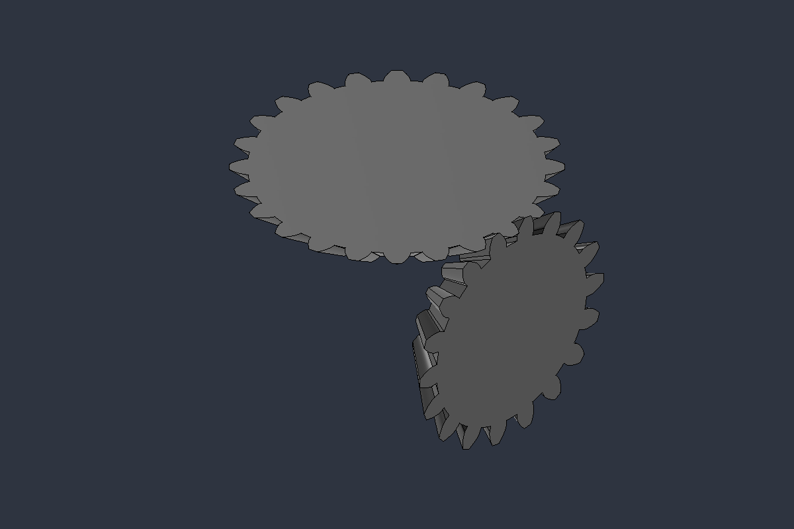

# ProGear 1.0 for Autodesk Fusion

ProGear creates gears, racks, and gear pairs in Autodesk Fusion. A live 3D preview shows the geometry on the canvas before you click **OK**. When you confirm, Fusion adds the solid bodies, sketches, and features to the design history.

[Installation](#installation) · [Quick start](#quick-start) · [Commands](#commands) · [Sizing](#sizing) · [Settings reference](#settings-reference) · [Examples](#examples) · [Troubleshooting](#troubleshooting)

## Installation

Copy the entire [ProGear](ProGear) folder into the add-in directory. Keep `ProGear.py` and `ProGear.manifest` directly inside the folder alongside `resources`.

| Platform | Add-in directory |
| --- | --- |
| macOS | `~/Library/Application Support/Autodesk/Autodesk Fusion 360/API/AddIns/` |
| Windows | `%APPDATA%\Autodesk\Autodesk Fusion 360\API\AddIns\` |

In Fusion, open **Utilities → Scripts and Add-Ins → Add-Ins**, select **ProGear**, and click **Run**. If ProGear is absent from the list, click **+** and select the add-in folder. The panel appears under **Design → Solid → ProGear**. [Autodesk add-in installation guide](https://www.autodesk.com/support/technical/article/caas/sfdcarticles/sfdcarticles/How-to-install-an-ADD-IN-and-Script-in-Fusion-360.html)

Use a document with design history enabled. In **Part Design**, ProGear creates individual gears and racks as bodies in the active component. In **Hybrid Design**, it creates them as separate components. Bevel and worm pairs require **Hybrid Design**. To convert the current document, expand **Document Settings** in the Browser and choose **Convert Design Type → Hybrid Design**. [Convert a design's type in Fusion](https://help.autodesk.com/cloudhelp/ENU/Fusion-Designs/files/ASM-CONVERT-DESIGN-TYPE.htm)

## Quick start

1. Open **Design → Solid → ProGear → Spur gear**.
2. Set **Size by** to **Tip diameter**. Enter `26 mm` for **Diameter** and `24` for **Teeth**.
3. Set **Face width** to `8 mm` and **Pressure / flank angle** to `20 deg`. With the default addendum and zero profile shift, the readout shows a **1 mm module**, **24 mm pitch diameter**, and **26 mm tip diameter**.
4. To add a through bore, expand **Tooth profile and machining** and set **Shaft bore diameter** to `5 mm`.
5. Click **OK** to create the model or **Cancel** to discard the preview.

ProGear remembers the last confirmed settings for each command during the current Fusion session. To read the main dimensions in the Browser, turn on visibility for the **Gear specification** sketch. For a pair, look in the shared parent component, or in the wheel component if grouping is off.

## Commands

| Command | Result |
| --- | --- |
| **Spur gear** | External spur gear |
| **Helical / herringbone gear** | External helical or herringbone gear with right- or left-hand teeth |
| **90° bevel pair** | Two straight bevel gears with shafts at 90° |
| **Straight / helical rack** | Straight or helical rack, depending on the **Helix angle** |
| **Worm drive** | Single-start right- or left-hand worm with a **Helical** or **Hobbed straight** wheel |
| **Internal spur gear** | Ring gear with straight internal teeth |
| **Inverted internal spur gear** | Internal spur gear with an inverted tooth profile |
| **Internal helical / herringbone gear** | Internal helical or herringbone gear |
| **Inverted internal helical gear** | Internal helical or herringbone gear with an inverted tooth profile |
| **Profile-shifted spur gear** | External spur gear with profile shift |
| **Profile-shifted helical gear** | External helical or herringbone gear with profile shift |

## Sizing

| **Size by** mode | Input |
| --- | --- |
| **Metric presets** | Select a nominal module from **Module preset**, such as `m0.5 mm`, `m1.25 mm`, or `m3 mm`. Set the tooth count and face width separately. |
| **Manual module** | Enter a module in millimeters, for example when matching an existing gear. |
| **Pitch diameter** | Enter the diameter of the pitch circle. ProGear calculates the module from the diameter, tooth count, and helix settings. |
| **Tip diameter** | Enter the diameter across the tooth tips. This is the outside diameter of an external gear or the minimum opening diameter of an internal gear. |
| **Diametral pitch (teeth/in)** | Enter the diametral pitch in teeth per inch. For example, `25.4` corresponds to a module of `1 mm`. |

For a bevel pair, both diameter modes apply to the large end of the **Wheel**. For a worm drive, they apply to the wheel. Racks use module or diametral pitch. Fusion length fields accept expressions with units, such as `0.5 in`.

For a spur gear, pitch diameter equals module multiplied by tooth count. For a helical gear, use the transverse module in that formula. **Module and angle measured in** sets the reference plane for the manual module and pressure angle. Metric presets for helical cylindrical gears and racks specify the normal module. If you select **Transverse plane**, ProGear converts the preset to the transverse module.

Presets include ISO 54:1996 modules for cylindrical gears, fine modules from DIN 780-1 Series I, and ISO 678:1976 modules for straight bevel gears. Worm drives have a separate set of starting metric sizes. [ISO 54](https://www.iso.org/standard/22644.html) · [DIN 780-1](https://www.dinmedia.de/en/standard/din-780-1/710428) · [ISO 678](https://www.iso.org/standard/4846.html)

## Settings reference

| Field | What it controls |
| --- | --- |
| **Teeth**, **Wheel teeth**, **Pinion teeth** | Tooth count for the gear, rack, or respective gear in a bevel pair. The input range is 6–250. Valid tooth profiles depend on the other settings. |
| **Face width** | Axial width of a gear or the width across the length of a rack. For a herringbone gear, this is the combined width of both halves. |
| **Face width on pitch cone** | Face width of the bevel pair measured along the pitch cone. |
| **Pressure / flank angle** | Pressure angle, which determines the shape of the tooth flank. The default is 20°, with a range of 10° to 35°. |
| **Helix angle**, **Left-hand helix** | Angle and hand of the teeth or worm thread. The angle input accepts 0° up to, but excluding, 89.5°. For worm drives, ProGear calculates the angle from the module and core radius. |
| **Herringbone (double helix)** | Two halves with opposite helix directions on one gear. Use a nonzero **Helix angle**. |
| **Ring wall thickness**, **Rack base thickness** | Wall thickness outside an internal gear's tooth roots or base thickness below a rack's tooth roots. |
| **Worm core radius**, **Worm length** | Core radius and overall axial length of the worm. The minimum length is one axial pitch, `π × module`. |
| **Put both gears in one parent component** | Enabled by default. Places the two gear components under one shared parent. Disabling it creates both components directly under the active component. |

Expand **Tooth profile and machining** for the following settings. Available fields vary by command.

| Field | What it controls |
| --- | --- |
| **Addendum (× module)** | Tooth height from the pitch circle to the tip. On an unshifted spur gear, a 2 mm module and an addendum of 1 give a height of 2 mm. |
| **Dedendum (× module)** | Tooth depth from the pitch circle to the root. On an unshifted spur gear, a 2 mm module and a dedendum of 1.25 give a depth of 2.5 mm. |
| **Profile shift coefficient** | Profile shift of an external cylindrical gear. The input range is −1 to 1, with the valid value also limited by the tooth heights. |
| **Pitch-line tooth thinning** | Reduction in tooth thickness on the pitch line, in millimeters. For internal gears, it widens the tooth spaces. |
| **Shaft bore diameter**, **Pinion bore diameter** | Diameter of the through bore. Set it to zero to omit the bore. For bevel gears, each bore must fit within the root circle at the small end. |
| **Tooth tip chamfer distance**, **Tooth tip chamfer angle** | Size and angle of material removal at the tooth tips on both end faces. A distance of zero omits the chamfer. |
| **Pinion axial offset (× module)** | Axial displacement of the bevel pinion for assembly clearance. The default is `0.2 × module`. |
| **Center-distance increase (× module)** | Additional center distance for a worm pair. The default is `0.15 × module`. |
| **Fast involute calculation** | Uses fewer points to generate the involute profile and speeds up modeling. |

## Examples

### Internal gear with a specified opening diameter

Open **Internal spur gear**. Select **Size by → Tip diameter** and enter `46 mm`. Set **Teeth** to `48`, **Face width** to `8 mm`, and **Ring wall thickness** to `5 mm`. With the default profile, the module is **1 mm**, the pitch diameter is **48 mm**, and the ring's outside diameter is **60.5 mm**.

### Herringbone gear

Open **Helical / herringbone gear**. Select module `m1 mm` and **Normal plane**. Set **Teeth** to `24`, **Helix angle** to `15 deg`, and **Face width** to `8 mm`. Enable **Herringbone (double helix)**. ProGear creates two halves, each 4 mm wide, with opposite helix directions.

### 90° bevel pair

In **Hybrid Design**, open **90° bevel pair**. Select `m1 mm` from ISO 678 Series I. Set **Wheel teeth** to `24`, **Pinion teeth** to `18`, and **Face width on pitch cone** to `5 mm`. Keep **Pinion axial offset** at `0.2` and enable **Put both gears in one parent component**. The Browser shows one parent component with two gears.

*The 24/18-tooth pair from this example, captured in Fusion.*

### Straight rack

Open **Straight / helical rack**. Select module `m1 mm`. Set **Teeth** to `20`, **Helix angle** to `0 deg`, **Face width** to `8 mm`, and **Rack base thickness** to `5 mm`. The tooth pitch is about **3.142 mm**, and the rack is about **62.83 mm** long.

### Worm drive

In **Hybrid Design**, open **Worm drive**. Choose **Wheel tooth form → Helical**, module `m1 mm`, **Transverse plane**, and **Teeth** `24`. Set **Worm core radius** to `5 mm`, **Worm length** to `20 mm`, and **Face width** to `8 mm`. To model a wheel cut by a worm hob, choose **Hobbed straight**. The modeled cutter determines the tooth shape, so Fusion hides some manual profile settings in this mode.

## Troubleshooting

| What you see in Fusion | What to check |
| --- | --- |
| The **ProGear** panel is missing | Open **Scripts and Add-Ins → Add-Ins**, check the folder path, and click **Run**. Then open **Design → Solid**. |
| **Use a Hybrid Design…** | Change the document type to **Hybrid Design**. |
| **Use a design with Capture Design History enabled.** | Use a document with design history enabled. |
| **Teeth cross or vanish.** | Reset **Addendum** to 1, **Dedendum** to 1.25, the pressure angle to 20°, and tooth thinning to zero. Change one setting at a time and check the status readout. |
| Bore or chamfer error | Reduce the bore diameter or chamfer distance. To test the base profile, set the respective field to zero. |
| The preview is slow | Turn off **Live 3D preview** to build only when you click **OK**. Keep **Fast involute calculation** enabled for involute gears. |

## Modeling limits

ProGear approximates straight bevel gear geometry by scaling sections along the pitch cone. Cylindrical tooth profiles extend radially below the base circle. The metric presets specify nominal modules. Testing in Fusion on macOS covered model generation for all gear families and static interference in sample pairs using the default assembly clearances. Full-cycle contact, strength, and manufacturing tolerances require separate checks for each pair.

## Source code

ProGear builds on [GF Gear Generator](https://github.com/CenturySturgeon/GF-Gear-Generator) and adapts its method for modeling the worm and hobbed wheel. See [ProGear/LICENSE](ProGear/LICENSE) for the BSD 3-Clause license.

- [ProGear.py](ProGear/ProGear.py) defines the Fusion commands and dialogs.
- [gear_math.py](ProGear/gear_math.py) calculates sizes and tooth profiles.
- [model.py](ProGear/model.py) and [worm.py](ProGear/worm.py) build the geometry in Fusion.

Run the geometry tests outside Fusion with `python3 -m unittest discover -s tests -v`.
